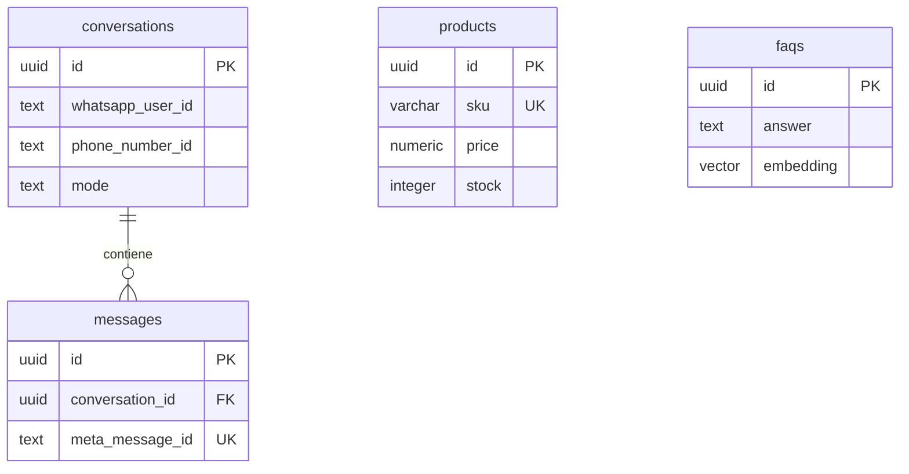

# Sprint 0: diseño inicial

## Alcance

Consulta de catálogo y políticas, memoria de conversación y solicitud de atención humana. Pedidos, pagos, reservas y modificaciones del catálogo quedan pendientes de definir. Los importes y productos de prueba son ficticios; BOB es una suposición configurable.

## Casos de uso y aceptación

| Intención | Herramienta | Resultado esperado |
| --- | --- | --- |
| Precio o características | buscar_producto | Responder con datos recuperados y moneda |
| Disponibilidad de SKU | verificar_stock | Informar stock actual sin prometer reserva |
| Producto ambiguo | buscar_producto | Mostrar hasta 3 opciones y pedir precisión |
| Producto agotado | verificar_stock, buscar_producto | Informar agotamiento y buscar alternativas relevantes |
| Envío, pago o cambios | consultar_faq | Usar únicamente políticas aprobadas |
| Sin coincidencias | buscar_producto | Explicar que no hay resultados y pedir otro término |
| Solicitud de persona | derivar_humano | Registrar derivación y pausar el bot |
| Tema ajeno al negocio | Ninguna | Redirigir brevemente a catálogo o atención |
| Mensaje duplicado | Ninguna | No crear otra respuesta ni otra tarea |

## Modelo relacional

Cada participante tiene una conversación por número comercial. Los productos y las FAQ se consultan independientemente. Los precios se conservan como cadenas decimales para evitar errores de coma flotante. `updated_at` requiere actualización explícita en cada escritura; el valor por defecto solo cubre inserciones.

## Contratos de ejecución

Todas las herramientas devuelven `{ ok, data, error }`; un error incluye un código estable y un mensaje seguro. Las búsquedas sin coincidencias son éxitos con una lista vacía. SKU inexistente devuelve `NOT_FOUND`; fallo de base de datos devuelve `UNAVAILABLE`. Validar entradas y límites en el servidor y utilizar consultas parametrizadas. El identificador de conversación se obtiene del contexto autenticado, nunca de argumentos del modelo.

Guardar los mensajes del asistente con sus llamadas de herramientas y cada resultado con `tool_call_id` para reconstruir una secuencia válida. La herramienta de derivación actualiza el modo de forma transaccional; una futura integración de atención humana confirmará la asignación real.

## Decisiones para el Sprint 2

- Habilitar `CREATE EXTENSION IF NOT EXISTS vector` antes de crear las tablas. Las 1536 dimensiones son provisionales y deben coincidir con el modelo de embeddings elegido.
- Verificar la firma sobre los bytes originales del webhook antes de aceptar eventos.
- Persistir el evento en una cola duradera antes del HTTP 200; una tarea solo en memoria puede perderse al reiniciar. Añadir una tabla de trabajos o un servicio de cola con reintentos y recuperación.
- Procesar en orden por conversación y deduplicar por identificador de mensaje. Registrar un mensaje no basta para garantizar que su respuesta se envió.
- Usar una bandeja de salida persistente para envíos y tratar el resultado incierto de una petición a Meta: no se puede prometer entrega exactamente una vez.
- Evitar almacenar tokens, firmas o payloads completos en registros. Definir retención y borrado del historial antes de producción.
- Medir latencia de aceptación, cola, base de datos, inferencia y envío por separado. Los tiempos del contexto son objetivos por verificar, no garantías.

## Pendientes de configuración

Confirmar rubro del catálogo, moneda, políticas comerciales, mecanismo de atención humana, región y disponibilidad de Azure, presupuesto y despliegues de modelos. No se han aprovisionado recursos ni validado elegibilidad, precios o latencias de proveedores.
